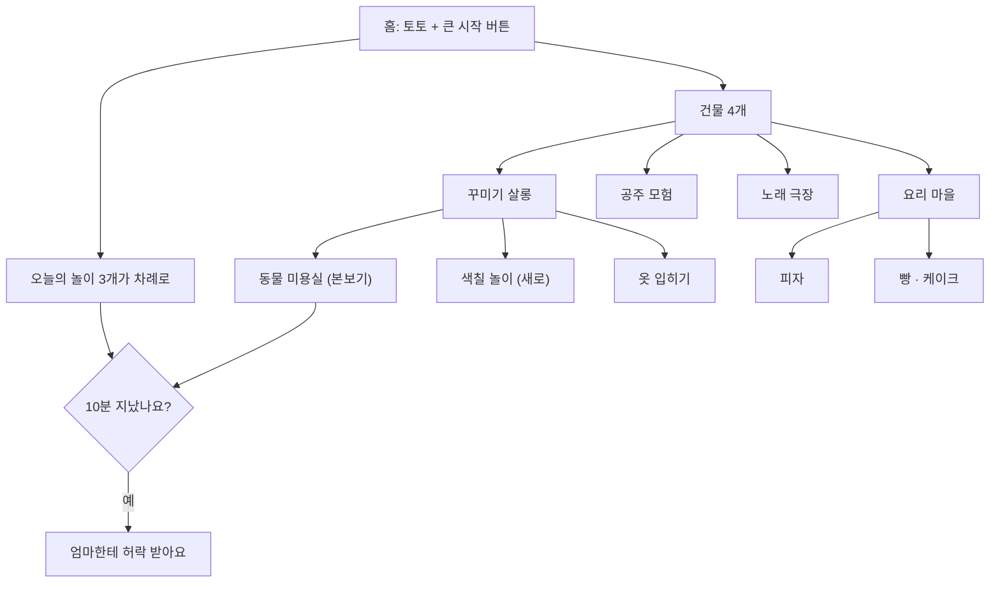
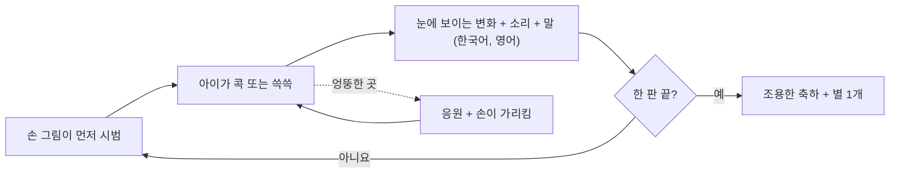
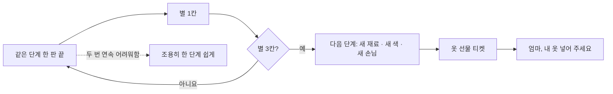
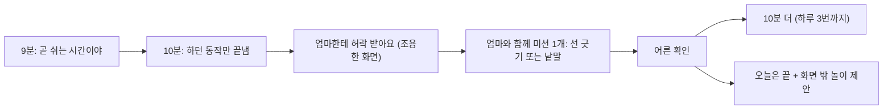

# 말랑 놀이터 설계 묶음

만 2세(29개월, 2024년생) 아이를 위한 놀이 앱의 **구상도, 설정 파일, 단계별 요청문**입니다.
구현은 쏘넷이나 오퍼스가 하고, 이 폴더는 그 모델이 그대로 따라 하도록 쓴 것입니다.

| 파일 | 내용 | 누가 읽나 |
|---|---|---|
| `README.md` | 구상도, 단계 순서, 넘기는 방법 | 사람, 모델 |
| `config.json` | 모든 숫자·문구·단계표 (**유일한 기준**) | 모델 |
| `벤치마킹.md` | 다른 앱에서 배운 것과 출처 | 사람, 모델 |
| `P1.md` ~ `P6.md` | 단계별 요청문. 하나씩 순서대로 넘김 | 모델 |

기존 문서와 다르면 **이 폴더가 우선**입니다. (`개선명세.md`: 화면별 문제와 그림 규칙, `스타일견본.html`: 그림체, `salon.js`: 본보기 코드)

---

## 1. 한눈에 보는 구상도

### 앱 구조


### 놀이 한 판 (모든 놀이 공통)


### 단계 올라가기


### 10분 약속


---

## 2. 이번에 정한 것 (요청 → 결정)

| 요청 | 결정 | 설정 위치 |
|---|---|---|
| 문지르기가 아직 어려움 | 닿는 순간부터 진행, 조금만 움직여도, 누르고만 있어도 천천히 진행. 필요한 양을 절반으로 | `touch.rub` |
| 소리 날 때 영어 표현도 | 칭찬 9가지를 한국어 다음 영어로 (Beautiful, Awesome …). 고른 것은 "분홍 리본! Pink ribbon!" | `voice` |
| 같은 단계 3번이면 다음 단계 | 별 3칸이 차면 새 재료·새 색·새 손님이 열림. 어려워하면 조용히 내려감 | `progress`, `games` |
| 씻기고 말릴 때 변하는 모습 | 진흙 → 거품 → 헹굼 3칸 → 젖음 → 말림 3칸 → 보송, 누를 때마다 한 칸씩 | `games.petsalon.petStates` |
| 드라이기를 무서워함 | 얼굴 있는 드라이기 친구, 소리 나기 전에 미리 말해 줌, 아이가 눌러야만 켜짐, 작은 소리부터 조금씩 | `sound.dryer` |
| 배경음에 동요 | 저작권이 끝난 가락 5곡을 오르골 소리로 조용히 | `sound.bgm` |
| 10분마다 허락 받기 | 10분 팝업 → 엄마와 미션 1개 → 어른 확인 → 10분 더 (하루 3번) | `gate` |
| 가족 얼굴 (아기, 엄마, 삼촌, 할머니) | 얼굴 자리 7개. 미용실 손님·인형·화장 얼굴로 등장 | `cast` |
| 단계 깨면 내 옷 넣기 | 단계가 오르면 티켓 → 엄마에게 부탁 화면 → 사진 → 배경 지우기 → 옷장 | `wardrobe` |
| 시각 자극 줄이기 | 채도 낮춘 색, 무늬 없는 배경, 움직이는 것 2개까지, 색종이 대신 조용한 별 | `calm` |

### 잠금을 "어려운 선 긋기"로 푸는 것에 대한 의견
- 29개월은 선 긋기가 아직 서툴러서, 어려운 선을 **열쇠**로 쓰면 풀지 못해 울거나 선 긋기를 싫어하게 될 수 있습니다.
- 그래서 **"엄마와 같이 하는 미션 1개"** 로 정했습니다. 아이 수준에 맞는 선 긋기 한 줄이나 낱말 2개이고, 도움을 충분히 줘서 반드시 끝납니다. 끝나면 어른 확인 버튼이 나옵니다.
- 원하면 `gate.mode`를 `parent_only`로 바꿔 미션 없이 어른만 풀게 할 수 있습니다.

---

## 3. 단계별 진행 (하나씩 넘기세요)

| 단계 | 내용 | 권장 모델 | 왜 |
|---|---|---|---|
| **P1** | 편한 터치 + 차분한 화면 + 영어 칭찬 + 소리와 동요 (미용실에 적용) | 쏘넷 | 규칙이 분명한 수정 |
| **P2** | 변하는 모습 6단계 + 별 3칸 단계 올라가기 | 오퍼스 | 그림을 새로 그려야 함 |
| **P3** | 10분 약속 (허락 화면, 미션, 어른 확인) | 쏘넷 | 흐름이 정해져 있음 |
| **P4** | 가족 얼굴 넣기 | 쏘넷 | 기존 사진 기능 확장 |
| **P5** | 색칠 놀이(새로) + 요리 단계 | 오퍼스 | 새 놀이와 그림 |
| **P6** | 내 옷 넣어 주세요 | 쏘넷 | 기존 옷장 기능 연결 |

한 단계가 끝나면 **아이에게 해 보게 한 뒤** 다음으로 넘어가세요. 관찰한 것을 다음 요청에 한 줄 덧붙이면 됩니다.

### 넘기는 말 (복사해서 쓰세요)
```
말랑놀이터/설계/README.md 와 config.json 을 읽고, 말랑놀이터/설계/P1.md 를 그대로 구현해 주세요.
끝나면 P1.md 의 '완료 기준' 검사를 돌린 결과와, 바꾼 파일 목록을 알려 주세요.
P1.md 에 없는 것은 만들지 마세요.
```
(P2부터는 `P1`만 바꿔서 쓰면 됩니다.)

---

## 4. 모든 단계에서 지킬 것
1. 숫자와 문구는 `config.json`에서 읽습니다. 코드에 직접 쓰지 않습니다.
2. 아이 화면에는 글 안내와 이모지가 없습니다. 그림은 `스타일견본.html` 그림체로, 색은 `calm.palette`로.
3. 동작은 콕, 쓱쓱, 카드 고르기뿐입니다 (`touch.banned` 참고).
4. 엉뚱한 곳을 누르면 진행하지 않고 응원합니다. 대신 해 주지 않습니다.
5. 다른 앱의 캐릭터·그림·노래는 넣지 않습니다. 방식만 참고합니다.
6. 파일을 바꾸면 `sw.js`의 `CACHE` 숫자를 올립니다.
7. 끝낼 때마다 `node tests/audit.js`, `node tests/monkey.js`, 해당 놀이 테스트를 돌립니다.
