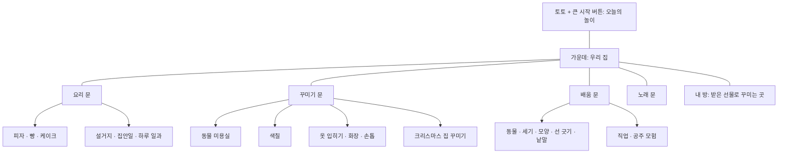
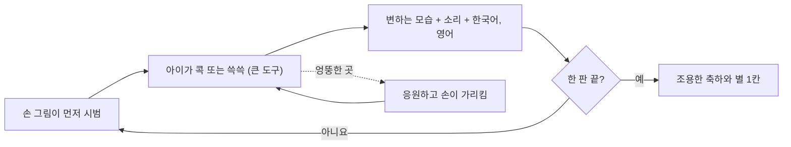
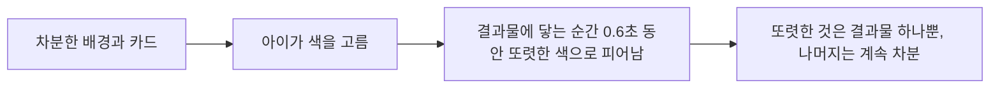
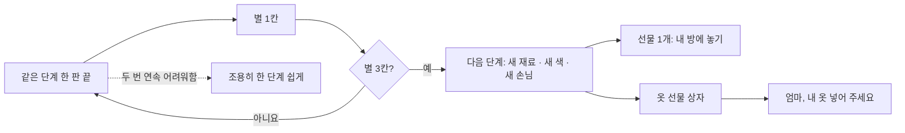
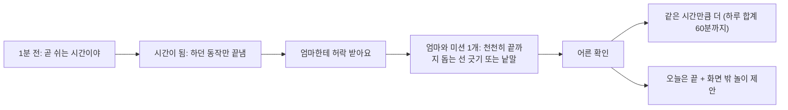
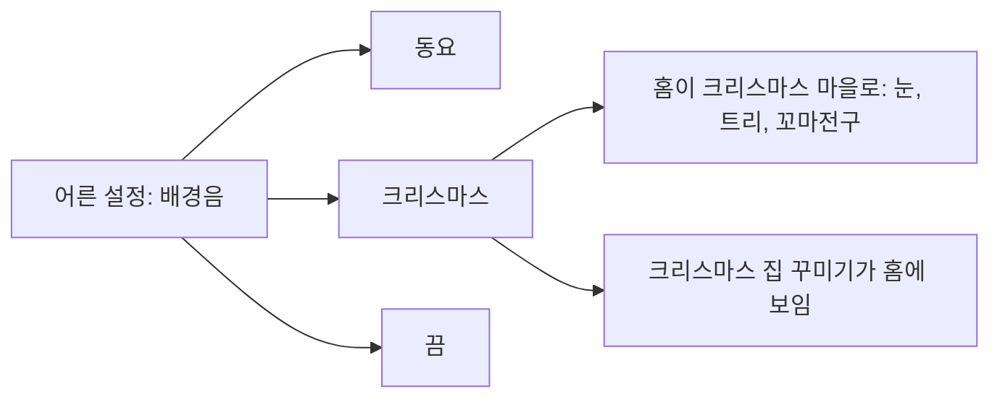
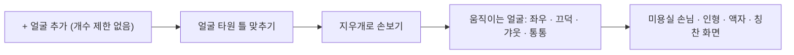

# 말랑 놀이터 설계 묶음 (2판)

만 2세(29개월, 2024년생) 아이를 위한 놀이 앱의 **구상도, 설정 파일, 단계별 요청문**입니다.
구현은 쏘넷이나 오퍼스가 하고, 이 폴더는 그 모델이 그대로 따라 하도록 쓴 것입니다.

| 파일 | 내용 | 누가 읽나 |
|---|---|---|
| `README.md` | 구상도, 가능 여부, 단계 순서, 넘기는 방법 | 사람, 모델 |
| `config.json` | 모든 숫자·문구·단계표 (**유일한 기준**) | 모델 |
| `벤치마킹.md` | 다른 앱에서 배운 것과 출처 | 사람, 모델 |
| `P1.md` ~ `P9.md` | 단계별 요청문. 하나씩 넘김 | 모델 |

기존 문서와 다르면 **이 폴더가 우선**입니다. (`개선명세.md`: 화면별 문제와 그림 규칙, `스타일견본.html`: 그림체, `salon.js`: 본보기 코드)

---

## 1. 구상도

### 홈 (숫자마스터처럼 한 화면에)


### 놀이 한 판


### 색: 고를 땐 차분하게, 결과는 또렷하게


### 단계 올라가기와 선물


### 시간 약속 (10 · 15 · 20 · 30분 중 선택)


### 배경음과 테마


### 가족 얼굴


---

## 2. 반영 가능한지 확인한 결과

| 요청 | 가능 여부 | 설명 | 단계 |
|---|---|---|---|
| 도구를 크게 (문지르기) | 가능 | 도구 그림을 화면 폭의 32%(최소 130px)로, 손가락에 가려지지 않게 위쪽에 보임 | P1 |
| 저작권 없는 노래 더 | 가능 | 동요 10곡 + 캐럴 6곡의 **가락**을 넣음. 오르골 소리로 앱이 직접 연주 | P1, P7 |
| 실제 노래(가사·반주) | **어려움** | 녹음된 음원이 없고 가사는 저작권이 남은 것이 많음. 가락만 가능 | - |
| 크리스마스 배경음 고르면 홈도 크리스마스 | 가능 | 눈, 트리, 꼬마전구, 토토 목도리를 새로 그림. 깜빡임 없이 은은하게 | P7 |
| 크리스마스 집 꾸미기 | 가능 | 새 놀이. 트리 방울, 별, 전구 켜기, 양말, 선물 | P7 |
| 허락 시간 10·15·20·30분 | 가능 | 어른 설정에서 고름. 권장은 15분, 하루 합계 60분 | P3 |
| 얼굴 자리 계속 추가 | 가능 | 개수 제한 없음. 사진이 많아져서 저장 방식을 바꿈 | P4 |
| 얼굴만 따기 | **조건부** | 타원 틀을 손으로 맞추고 지우개로 손보는 방식은 가능. 자동으로 얼굴을 찾아 주는 건 기기에 따라 됨/안 됨 | P4 |
| 움직이는 이모티 | **조건부** | 고개 돌리기·끄덕·갸웃·통통과 볼 빨개짐·하트 같은 효과는 가능. 사진 한 장으로 표정 자체를 바꾸는 건 불가. 대신 표정 사진을 3장까지 넣으면 바꿔 보여 줌 | P4 |
| 신발, 머리띠 등 | 가능 | 종류 7가지(옷, 신발, 머리띠·모자, 목걸이, 안경, 가방, 인형) | P6 |
| 고를 땐 차분, 결과는 또렷 | 가능 | 좋은 방법입니다. 화면에서 또렷한 것은 결과물 하나뿐이라 자극이 줄고 성취는 잘 보임 | P1 |
| 만들어진 놀이 전부에 같은 방식 | 가능 (양이 많음) | 20개 놀이의 단계표를 `config.json`에 넣음. 네 묶음으로 나눠 진행 | P8 |
| 선 긋기를 천천히 끝까지 돕기 | 가능 | 굵은 길, 근처만 가도 인정, 닿아 있으면 조금씩 나아감, 90%에서 완성, 실패 없음 | P3, P8 |
| 숫자마스터 방식 | 가능 | 가운데 집 + 둥근 문 4개 + 내 방, 단계 올리기 | P2, P9 |
| 종이 공예 그림체 (입체감) | 가능 (견본 완성) | 코드로 그린 종이 겹 + 그림자 + 종이 결. `ART.paper()`, 스타일견본 7번 | P9 |
| 진행을 그림으로 (문 그림이 자람, 당근 바구니) | 가능 | 숫자 대신 그림 개수. 세부 단계 칸은 어른 화면에 | P9 |
| 웅진·빨간펜 반영 | **확인 필요** | 2~4세용 앱 화면을 찾지 못함. 캡처를 주시면 반영 | - |

---

## 3. 단계별 진행

| 순서 | 단계 | 내용 | 권장 모델 | 상태 |
|---|---|---|---|---|
| 1 | **P1** | 큰 도구와 편한 문지르기, 차분한 색과 또렷한 결과, 영어 칭찬, 소리, 동요 | 쏘넷 | 끝 |
| 2 | **P2-가** | 미용실: 가게 앞 손님 고르기, 움직이는 도구, 자유 꾸미기 | 오퍼스 | 끝 |
| 3 | **P10** | 자연스러운 목소리, 엄마 목소리 녹음 | 쏘넷 | 끝 |
| 4 | **P11** | 진짜 네일숍 | 오퍼스 | 끝 |
| 5 | **P12-가** | 살아 있는 캐릭터, 큼직한 도구 | 오퍼스 | 진행 중 |
| 6 | **P5-나** | **피자가게 고치기 + 쇠규칙 검사기**(`tests/rules.js`): 만든 만큼 쓰기, 모든 재료 준비 과정, 글자 버튼 없애기 | 오퍼스 | 다음 |
| 7 | **P8-나** | 빵, 케이크, 설거지, 집안일, 하루 일과를 같은 규칙으로 (후~·식히기·물 주기 버튼 없애기) | 쏘넷 | |
| 8 | **P8-가** | 화장, 옷 입히기 (예전 손톱 놀이는 네일숍으로 대체) | 쏘넷 | |
| 9 | **P2-나** | 단계 엔진(3번 하면 다음 단계), 변하는 모습, 장식 늘어나기 | 오퍼스 | |
| 10 | **P12-나** | 진행 뼈대: 과정 그림 줄, 이음 장면, 보상 | 오퍼스 | |
| 11 | **P7** | 크리스마스: 캐럴, 홈 테마, 집 꾸미기 (**12월 전에**) | 오퍼스 | |
| 12 | **P9** | 홈 다시 짜기(한 화면, 큰 그림 4~5개)와 내 방 | 오퍼스 | |
| 13 | **P8-다, 8-라** | 배움 놀이, 직업과 모험을 같은 규칙으로 | 쏘넷 | |
| 14 | **P3** | 시간 약속 (10·15·20·30분), 천천히 돕는 선 긋기 | 쏘넷 | |
| 15 | **P4** | 가족 얼굴 | 쏘넷 | |
| 16 | **P6** | 내 옷·신발·머리띠·장식 사진으로 넣기 | 쏘넷 | |
| 17 | **P5-가** | 색칠 놀이(새로) | 오퍼스 | |

순서를 바꾼 이유: 실제로 써 보니 **예전에 만든 놀이의 잘못**(글자 버튼, 수가 안 맞음, 준비 과정 없음, 제각각인 배치)이 가장 크게 걸렸습니다. 새 기능보다 이것을 먼저 고칩니다.

한 단계가 끝나면 **아이에게 해 보게 한 뒤** 다음으로 넘어가세요.

### 넘기는 말 (복사해서 쓰세요)
```
말랑놀이터/설계/README.md 와 config.json 을 읽고, 말랑놀이터/설계/P1.md 를 그대로 구현해 주세요.
끝나면 P1.md 의 '완료 기준' 검사를 돌린 결과와, 바꾼 파일 목록을 알려 주세요.
P1.md 에 없는 것은 만들지 마세요.
```

---

## 4. 모든 단계에서 지킬 것
1. 숫자와 문구는 `config.json`에서 읽습니다. 코드에 직접 쓰지 않습니다.
2. 아이 화면에는 글 안내와 이모지가 없습니다. 그림은 `스타일견본.html` 그림체로(친구·물건은 1~6번 말랑 그림체, 문·지도·배경은 7번 종이 공예 그림체).
3. **색**: 배경·카드·버튼은 `calm.choiceColors[].hex`(차분), 아이가 만든 결과물만 `vivid`(또렷).
4. 동작은 콕, 쓱쓱, 카드 고르기뿐입니다 (`touch.banned`). 도구는 크게(`touch.tool`).
5. 엉뚱한 곳을 누르면 진행하지 않고 응원합니다. 대신 해 주지 않습니다. (선 긋기만 예외로 천천히 도와줍니다.)
6. 다른 앱의 캐릭터·그림·노래는 넣지 않습니다. `sound.bgm.neverUse`의 노래도 넣지 않습니다.
7. 파일을 바꾸면 `sw.js`의 `CACHE` 숫자를 올립니다.
8. 끝낼 때마다 `node tests/audit.js`, `node tests/monkey.js`, `node tests/rules.js`(P5-나 이후), 해당 놀이 테스트를 돌립니다.
9. **쇠규칙**(`config.json`의 `rules`): 글자를 읽어야 누를 수 있는 것 없음 · 버튼으로 건너뛰지 않고 직접 하기 · 만든 만큼 쓰기 · 모든 재료에 준비 과정 · 모든 화면이 같은 세 구역 배치.
